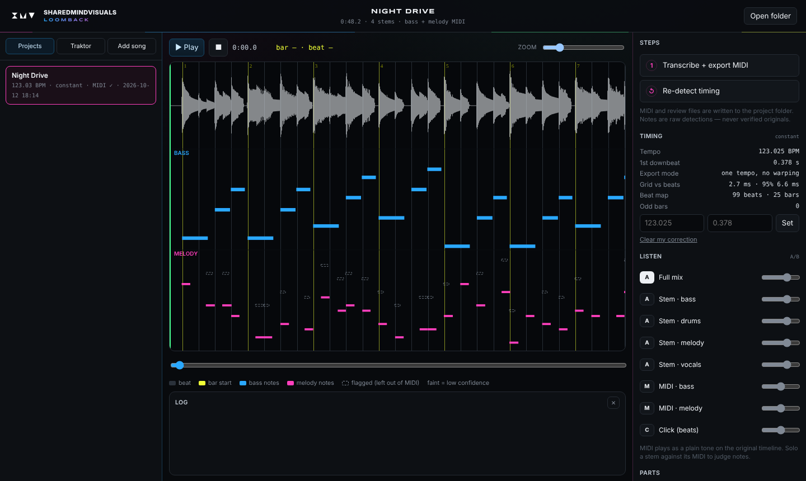

# Loomback — by SMV
*(project codename: AI Music Reconstruction Studio)*



**Open it on the Mac:** double-click `mac/Loomback.command`. It opens in your
browser, and nothing leaves the Mac.

Turns your finished songs (the full mix plus whatever stems you have) back into
editable **Ableton Live 12** projects: bass, melody and drum MIDI aligned to your
original audio, with your original vocals kept untouched.

**It reconstructs. It does not compose.** Notes it isn't sure of are marked as
uncertain, never passed off as exact, and missing notes are never invented.

## Status
| Sprint | Contents | State |
|---|---|---|
| 0 | Environment check, Live API test, transcription probe | ✅ done — Live API create/save/reopen verified |
| 1a | Audio import, Traktor stems, stem sync, tempo/downbeat | 🟡 Mac run pending |
| 1b | Bass + melody to MIDI, A/B review | ✅ ran on a real song (36 s, < 1 GB) |
| 1c | Beat map for drifting songs | ✅ verified by ear |
| 2 | Drums → GM MIDI | ✅ sounds good on a real song |
| 3 | Ableton builder (device) | 🟡 Live run pending |
| GUI v1 | Loomback: projects, Traktor picker, timeline, piano roll, A/B mixer, timing fixes | 🟡 tested in cloud browser; Mac pending |

## Start here
- **On the Mac:** [SETUP_MACOS.md](SETUP_MACOS.md)
- **How it's built:** [ARCHITECTURE.md](ARCHITECTURE.md)
- **Plan:** [ROADMAP.md](ROADMAP.md)
- **What has been measured:** [TEST_RESULTS.md](TEST_RESULTS.md)
- **Rules for contributors and AI agents:** [AGENTS.md](AGENTS.md)

## Analyse a song
```bash
.venv/bin/python -m mrs analyze "<song folder or file.stem.mp4>" --out <project folder>
.venv/bin/python -m mrs click <project folder>/project.json        # listen-check the grid
.venv/bin/python -m mrs tempo <project folder>/project.json --bpm 120 --downbeat 0.52
```
On the Mac: double-click `mac/4-analyze-song.command` and drag the song in.
For MIDI: `mac/6-transcribe-song.command` (does analysis too if needed).
```bash
.venv/bin/python -m mrs transcribe <project>/project.json      # bass + melody raw layers
.venv/bin/python -m mrs export <project>/project.json          # midi/, midi/raw/, review/, export.json
```

## Developer quick start
```bash
uv venv -p 3.11 .venv && uv pip install -p .venv/bin/python -r requirements.txt
.venv/bin/python -m pytest -q tests
.venv/bin/python tools/probe_transcription.py   # Basic Pitch vs pYIN on known notes
```
